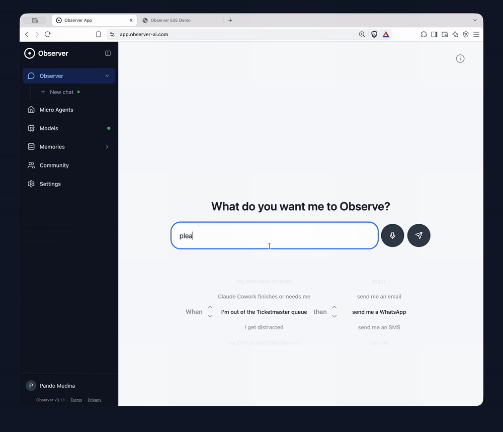

# Observer AI

[](https://github.com/Roy3838/Observer/releases/latest/)
[](LICENSE)
[](https://discord.com/invite/wnBb7ZQDUC)

Observer is an agent that deploys micro-agents that monitor your screen, camera and audio, and take action when something happens. It runs on local models, so your data stays **100% private**.



## What you can do

### When X then Y. 

- When my training crashes, call me.
- When I'm out of the queue, SMS me. 
- When I get distracted, WhatsApp me. 
- When my Steam game downloads, Telegram me. 
- When my overnight render fails, call me. 
- When I haven't made progress, WhatsApp me. 
- When an appointment is available, send me a Whatsapp. 
- When an item is back in stock, send me a Telegram.

## Get started

**Web app (no install):** open [app.observer-ai.com](https://app.observer-ai.com/) and download a model to run it in your browser.

**Desktop app (recommended):** download the [latest release](https://github.com/Roy3838/Observer/releases/latest/) for macOS, Windows or Linux. It ships with llama.cpp, so it runs any GGUF+mmproj model.

**Bring your own server:** in the app, set `Custom Model Server URL` to any OpenAI-compatible endpoint (Ollama, llama.cpp, vLLM). 

Then describe what you want Observer to watch, or build an agent yourself from the **Micro Agents** tab.

## How it works

Each micro-agent runs in a loop: **Sensors → Model → Code**.

```
You are an Observer agent. If you see the Observer logo say OBSERVER, otherwise say CONTINUE.
$SCREEN
```

```javascript
if (response.includes("OBSERVER")) {
  sendEmail("your@email.com", response, screen); // attaches the screenshot
}
```

<details>
<summary><b>Sensors</b></summary>

| Sensor | Description |
| --- | --- |
| `$SCREEN` | Screenshot for multimodal models |
| `$CAMERA` | Camera frame for multimodal models |
| `$MEMORY` / `$MEMORY@agent_id` | An agent's stored text (defaults to the current agent) |
| `$IMEMORY` / `$IMEMORY@agent_id` | An agent's stored images |
| `$CLIPBOARD` | Clipboard contents |
| `$MICROPHONE`\* | Microphone transcription |
| `$SCREEN_AUDIO`\* | Transcription of a shared tab's audio |
| `$ALL_AUDIO`\* | Mic and screen audio mixed (good for meetings) |

\* Transcribed with Whisper via transformers.js.

</details>

<details>
<summary><b>Tools</b></summary>

**Memory and agents** (`agentId` is optional and defaults to the running agent)
- `getMemory(agentId?)`, `setMemory(agentId?, content)`, `appendMemory(agentId?, content)`
- `getImageMemory(agentId?)`, `setImageMemory(agentId?, images)`, `appendImageMemory(agentId?, images)`
- `startAgent(agentId?)`, `stopAgent(agentId?)`
- `time()`, `sleep(ms)`

**Notifications**
- `sendDiscord(webhook, message, images?, videos?)`
- `sendTelegram(chat_id, message, images?, videos?)`: get your chat_id by messaging @observer_notification_bot
- `sendEmail(email, message, images?, videos?)`: must be your signed-in email
- `sendPushover(user_token, message, images?, title?)`
- `call(phone_number, message)`†
- `sendWhatsapp(phone_number, message, images?, videos?)`†
- `sendSms(phone_number, message, images?, videos?)`†: blocked for US/Canada (A2P policy)
- `notify(title, options)`: browser notification (some browsers block these)
- `sound(name?, volume?)`: local sound, no account needed

† Needs whitelisting: SMS or call +1 (863) 208-5341, or WhatsApp +1 (555) 783-4727.

**Video recording**
- `startClip()`, `stopClip()`, `markClip(label)`, `getVideo()`

**Desktop app**
- `ask(question, title?)`, `message(message, title?)`, `system_notify(body, title?)`
- `overlay(body)`, `click('left' | 'right')`, `celebrate()`

**Mobile app** (iOS 16+ and Android)
- `lockPhone(reason?, minutes?)`: blocks every other app on the phone until `unlockPhone()` or the timeout (default 30, max 720 minutes). Calling it again restarts the timer.
- `unlockPhone()`

</details>

<details>
<summary><b>Code tab variables</b></summary>

| Variable | Description |
| --- | --- |
| `response` | The model's response (`null` with a decision model) |
| `decision` | The decision model's answer (`null` with text models) |
| `agentId` | ID of the running agent |
| `screen`, `camera` | Captured images |
| `imemory` | The agent's current image memory |
| `images` | All images sent to the model |
| `prompt` | The model's prompt |
| `microphone`, `screenAudio`, `allAudio` | Transcriptions from this loop |

```javascript
const cleaned = response.replace(/<think>[\s\S]*?<\/think>/g, '').trim();
appendMemory(`[${time()}] ${cleaned}`);
if (response.includes("word")) {
  sendTelegram("12345678", cleaned);
}
```

</details>

<details>
<summary><b>Decision models</b></summary>

Decision models don't write text. They answer typed questions with probabilities, so `response` is `null` and the result is in `decision`.

**Plain-text prompt:** a single yes/no (`noul`) question.
```
Is there a person in the room? $CAMERA
```
```javascript
// { type: 'noul', noul: 0.94, start: 0.12, dropped: false }
if (decision.noul > 0.8) {
  sendTelegram("12345678", "Someone is in the room", camera);
}
```
- `noul`: probability of "yes" (0 to 1)
- `start`: average `noul` over the first 3 iterations
- `dropped`: `true` once `noul` has stayed well below `start` for 3 iterations (useful for "tell me when this finishes")

**JSON prompt:** several questions at once, keyed by id.
```json
{
  "state": "<image:1>",
  "questions": {
    "person": { "type": "noul", "instructions": "Is there a person?" },
    "pet": { "type": "choice", "instructions": "Which pet is visible?", "criteria": { "dog": "A dog", "cat": "A cat", "none": "No pet" } },
    "mess": { "type": "score", "instructions": "How messy is the room?", "criteria": ["Clean", "A bit messy", "Very messy"] }
  }
}
```
Add an image sensor (`$SCREEN`, `$CAMERA` or `$IMEMORY`) after the JSON. `<image:N>` marks where each image goes in the state; without markers, images go at the top.
```javascript
// decision.person → { type: 'noul', noul }
// decision.pet    → { type: 'choice', choice, probabilities, confidence }
// decision.mess   → { type: 'score', score, legend, probabilities, confidence }
if (decision.pet.choice === "dog" && decision.pet.confidence > 0.7) {
  appendMemory(`[${time()}] Dog spotted`);
}
```

</details>

## CLI

The desktop app bundles an `observe` CLI. Run `observe sleep 5` and Observer calls you when the command exits. To build it from source: `cd app && cargo build`.

## Self-hosting (deprecated)

- [Docker setup](docker/DOCKER.md)
- [Jupyter server](app/JUPYTER.md)

## Connect with us

Join the [Discord](https://discord.com/invite/wnBb7ZQDUC) or [r/ObserverAI](https://www.reddit.com/r/ObserverAI/) to share agents, ask questions and report bugs. You can also follow along on [YouTube](https://www.youtube.com/@Observer-AI), [X](https://x.com/AppObserverAI), [TikTok](https://www.tiktok.com/@observerai) and [Instagram](https://www.instagram.com/observer_ai.tech/).

Contributions are welcome: fork the repo, create a feature branch and open a pull request.

## Sponsors

[](https://signpath.org/)

Free code signing on Windows provided by [SignPath.io](https://signpath.io/), certificate by [SignPath Foundation](https://signpath.org/).

## License

[AGPLv3](LICENSE). Built by Roy Medina for the Observer AI community.
